## First
Working in a position where you're leveraged for more than a few specific areas has led me to see my limitations. Limitations by not always being able to become an expert in every facet of those areas. When you're expected to do so much and have so little time, you need to decide what's important and what's fluff. Which leads me to what I hope to accomplish with these next few posts. 

I've decided to finally start up a nested VMware lab on my gaming PC. Since I've had kids, it's mostly gone unused except for the occasional Witcher 3 session. Most gaming PCs today have an absurd amount of power, and I wanted to finally use it. Here's the parts list of my current rig.

| What          | Model |
| ---           | --- |
| CPU           | Intel i5-6600K @ 3.9GHz |
| Cooler        | Noctua NH-D9L |
| Motherboard   | Gigabyte GA-Z170MX-Gaming 5 |
| GPU           | MSI Radeon R9 390 |
| RAM           | G.SKILL Ripjaws V Series 24GB |
| PSU           | Seasonic SS-660XP2 |
| Case          | Corsair Carbide Series Air 240 |
| HDD OS        | Samsung 850 EVO 250GB |
| HDD Data      | Seagate BarraCuda 2TB |
| OS            | Windows 10 Pro |

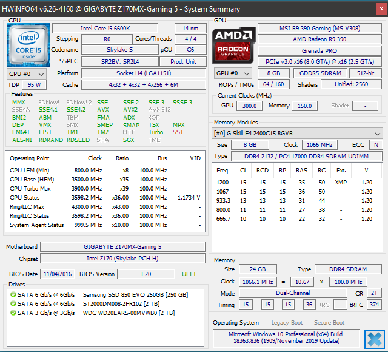

##### Info provided by HWiNFO65 (source: https://www.hwinfo.com/download/)

This hardware isn't new, I actually built this around Thanksgiving 2015, but it's still relatively powerful for gaming at 1080. The only upgrades I've done have been in 2020. I've added a 2 x 8GBs RAM kit to match my current RAM and added an additional 2TB drive for additional storage. I'm only running on air and have my 6600K overclocked to 3.9 on stock voltages.

I spent a lot of time trying to determine what I wanted to do with a lab, the overwhelming consensus I came across was to buy used server hardware. Post after post after post was the same thing, "buy server x off eBay, then you can buy x, y and z to make it functional". In the age of the cloud and how popular PC gaming has become, going the physical server route is not the right approach. So for those of you reading this, think outside of the vocal majority and find the right solution for you. I already have a gaming PC, no need to spend time and money on MORE hardware to accomplish the same thing. Plus, I don't have to worry about a larger footprint in my small office. The other factor that played into this, I already manage server hardware for part of my job. I don't want to manage that at home, I'd rather spend my time on other tasks.

## Second
Okay, okay, enough of the intro you say, let's get into the meat and potatoes of what I'm setting up. My plan is two ESXi 6.7 hosts and a singular vCenter 6.7. I'm deploying vCenter with an embedded platform controller since this will be a fairly small lab. I'm doing this using VMware Workstation 15 Pro. If you're wondering where I'm getting all of these VMware resources, I suggest you head on over to [VMUG](https://www.vmug.com/home) and take a look at there Advantage Membership. $200 gets you all you need to get started with VMware in your home lab and then some. If you look around the web, or even on the vmug site, you can usually find a 10% offer code to bring the total down to $180. I'm also going with VMware because I manage it at work and so I can have a lab to help me study for the VCP exam. If you're not looking to use the resources and knowledge you'll learn for this lab in a VMware enterprise environment, you could save some money and either use free ESXi or roll with Hyper-V, granted you’re running Windows 10 Pro. I've also heard proxmox is a great alternative, but this grants little to no help in the enterprise world where it's dominated by VMware, and now alternative cloud solutions.

Once you have your VMware resources downloaded, make sure you enable virtualization for your processor in your BIOS and install VMware workstation. Once installed, fire it up and we’ll want to create a virtual network. 

Navigate to Edit > Virtual Network Editor. Here we’ll want to setup the type of network our lab is communicating over. Since I want to manage these resources not only through VMwware workstation, but also from my local computer, I setup a NAT network. Add the network that’s appropriate for what you’re trying to accomplish. 

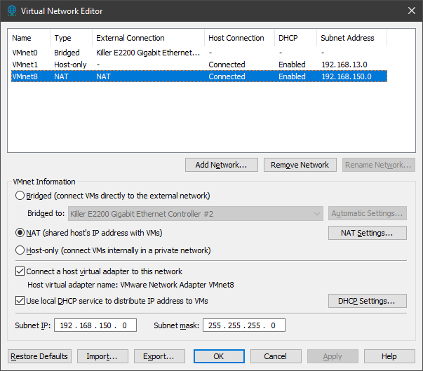

Now you’re ready to create your first VM (File > New VM). Select Typical and then next.

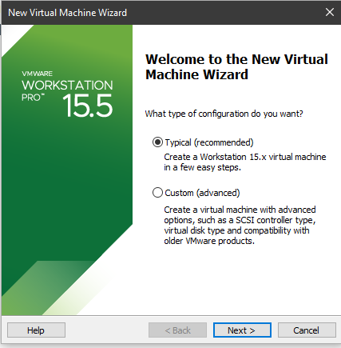

Select the ESXi iso you want to use. I’m going to be working with ESXi 6.7 since I’ve been working with it and that’s the VCP exam I’ll be attempting. Or crushing!

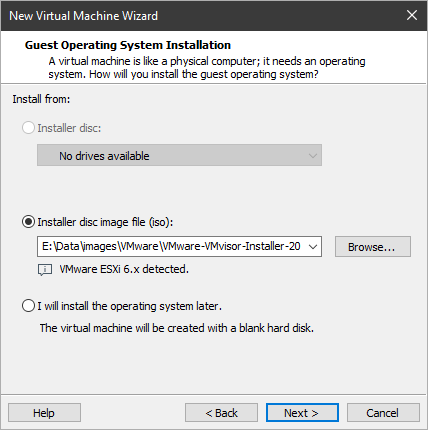

Give your VM a meaningful name, so as you expand your lab you can keep everything straight. Also select the storage location you want to use. I’ll be using one of my secondary data drives, and not the one that’s slower than a snail. Remember, these virtual hard drives are going to be acting as just that, hard drives. So if you put them on slow storage you’re going to experience significant slow downs. Especially during the deployments of ESXi and vCenter.

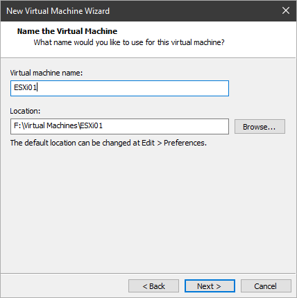

Next select your disk size and whether you want to use a single file or multiple files. In my lab I’m keeping the default to divide up the disks. Click next when you’re done. Note: you’ll need to add an additional 300GB disk to your ESXi servers. If you don’t have the actual space for it, no problem, we’ll be thin provisioning it so we’ll only take up what’s actually being used. Why 300GBs? Well vCenter requires at least a 300GB disk and it will not deploy successfully if you don’t have it. 

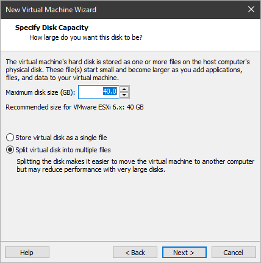

If you’re ready to configure ESXi keep the check box selected to power on the VM and click finish.

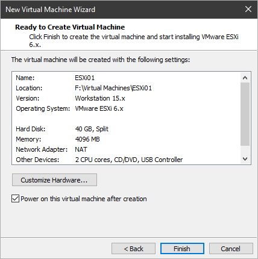

If you’re going to be running more than one ESXi host go ahead and configure another VM. I’ll be running two instances of ESXi so my vCenter can move between the two. If you’ve chosen not to power on your new vm, now’s a good time to add that secondary 300GB thin provisioned disk for vCenter.

## Third
Connect into your ESXi vm and we’ll walk through the install process. This installation is straight forward, first off you’ll select the storage device that you’d like to install ESXi on. Select the 40GB disk we created during the vm configuration. 

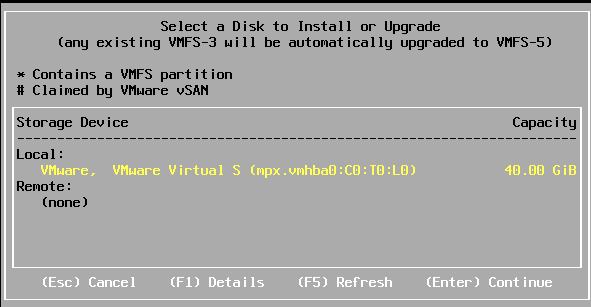

Select your keyboard layout and then enter a root password. This will be used for connecting into your ESXi host until we get vCenter up and running. You’ll need to make it a complex password or the installer will not let you continue. 

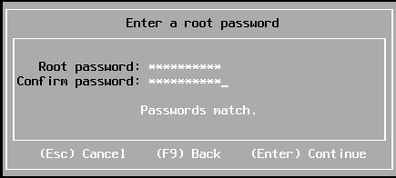

Finally push F11 to start your installation.

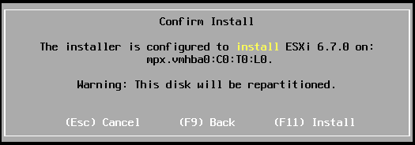

Once complete, you’ll be prompted to remove your install media. Navigate to your virtual machine settings and disconnect your CD/DVD device. More than likely you won't need it anymore, but if you do you’ll just need to reconnect it. Push enter when you’re ready to reboot.

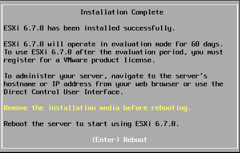

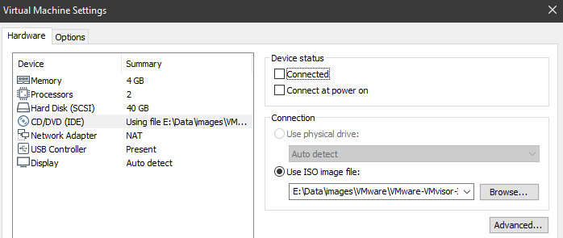

Once rebooted and the OS has loaded completely, you should be at a screen like the following.

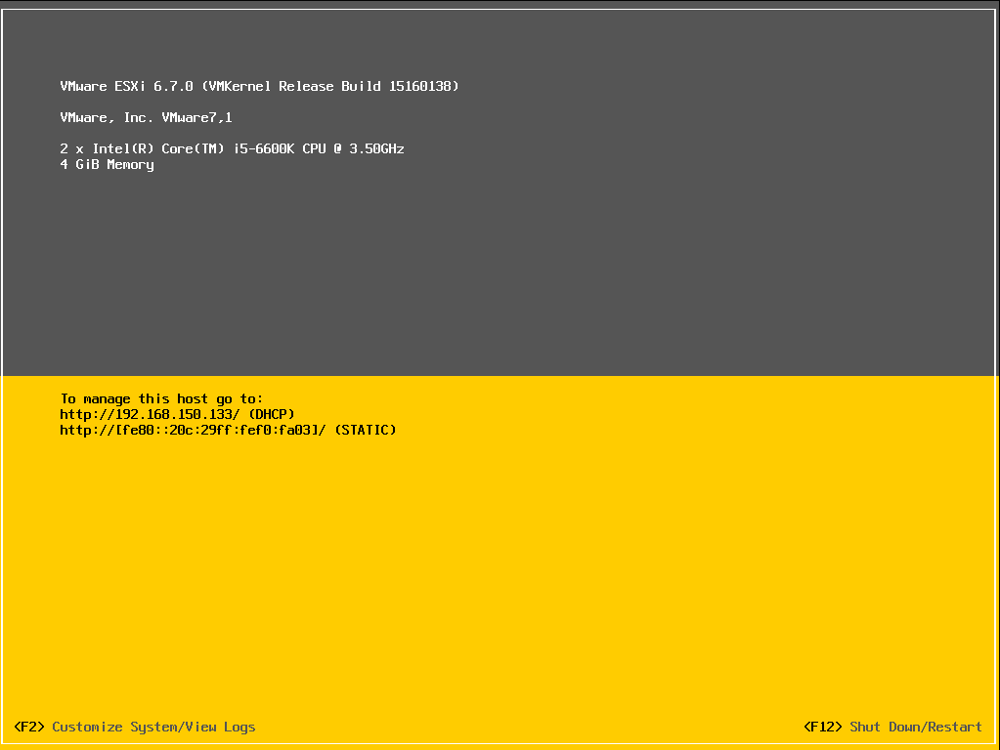

As you can see our ESXi host has a DHCP address, we should now be able to connect into it via the URL provided. You’ll want to set a static IP while we’re in here, leaving it DHCP could lead to major problems after we have our lab up and running. So push F2 and navigate to Configure Management Network and then IPv4 Configuration. 

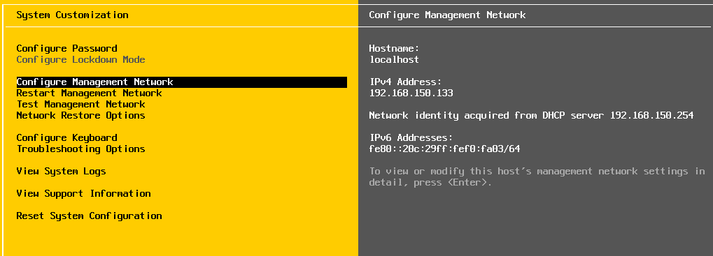

Set it to static and update it with whatever static IP you want that’s in range of the Virtual Network we set up previously.

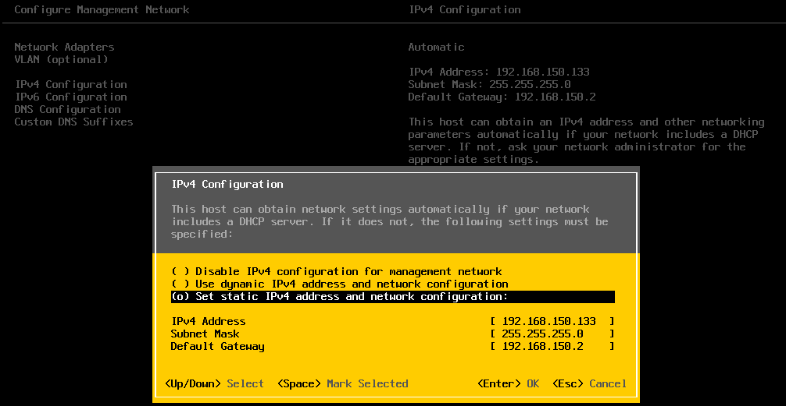

Once you’ve made those changes, you’ll need to restart the management network. Then you’ll be in business, you should be able to access your ESXi web interface.

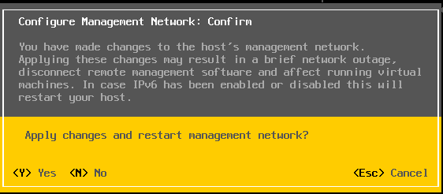

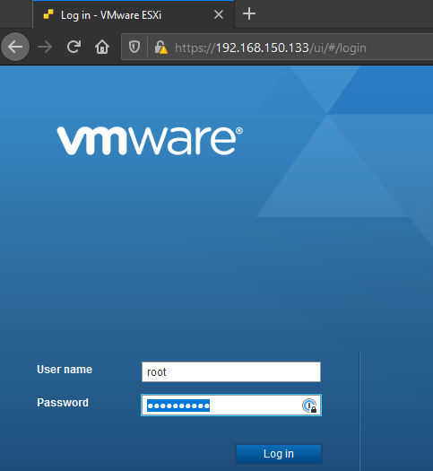

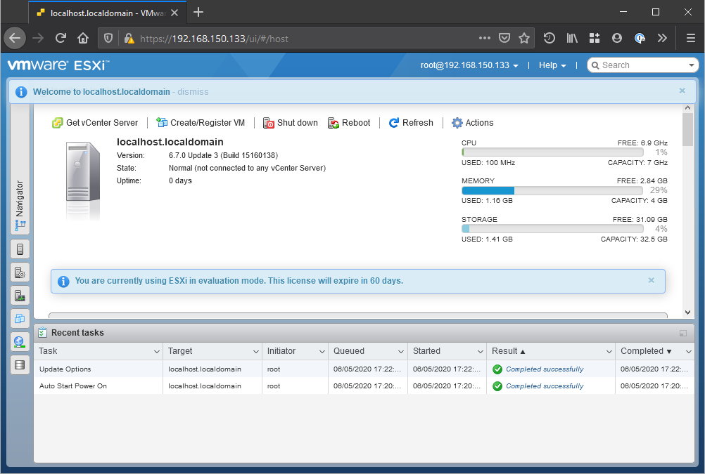